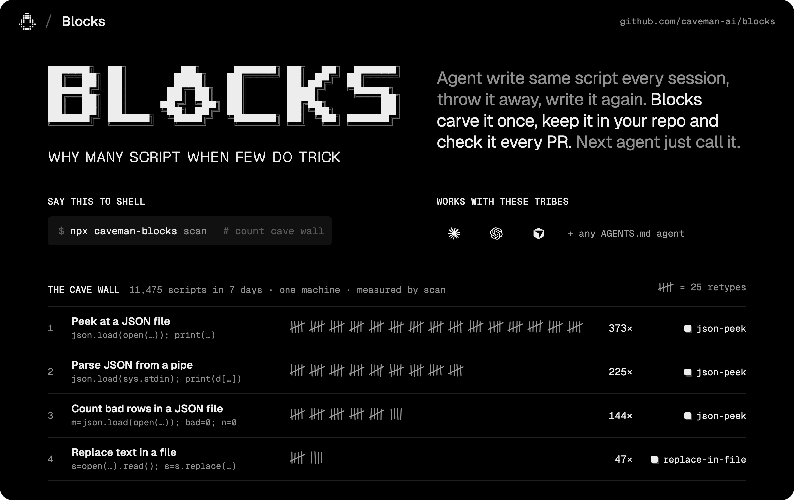

<a href="https://github.com/caveman-ai/blocks"></a>

# why many script when few do trick

**One developer's agents wrote the same little JSON inspector 394 times in a week. The transcripts told on them.**

Code mode works. An agent that writes a short script instead of calling tool after tool spends far fewer tokens; [Anthropic](https://www.anthropic.com/engineering/code-execution-with-mcp) took one task from 150,000 tokens to 2,000. Then the session ends, the script goes with it, and tomorrow the agent writes it again from memory, slightly different. [Purdue](https://arxiv.org/abs/2609.30725) put that habit at up to 9.57% of task cost.

Blocks keeps the script. A block is a plain Python file in `.blocks/`, committed with your code and listed by name in `AGENTS.md`. It proves it still works by running its own example. When your agent starts typing a heredoc that a block already covers, a shell hook slips it one line: use the block. The command still runs as written, and running a block makes zero LLM calls.

## One heredoc, two ways

<table>
<tr><th width="50%">Agent writes a script · 96 tokens</th><th width="50%">Agent calls a block · 16 tokens</th></tr>
<tr>
<td valign="top">

```bash
python3 - <<'EOF'
import json
ops=json.load(open('api.github.com.json'))
print(type(ops), (list(ops.keys())[:5] if isinstance(ops,dict) else len(ops)))
items = ops['operations'] if isinstance(ops,dict) and 'operations' in ops else ops
print(json.dumps(items[0] if isinstance(items,list) else list(items.items())[0], indent=1)[:800])
EOF
```

</td>
<td valign="top">

```bash
caveman-blocks run json-peek --path api.github.com.json
```

```text
{"kind": "object", "keys": ["openapi", "info", "tags", "servers",
 "externalDocs", "paths", … 14 more],
 "rows": 1, "sample": {"openapi": "3.0.3", …}, "truncated": true}
```

</td>
</tr>
</table>

That heredoc is real, lifted from a Claude Code transcript, and both commands ran against GitHub's 14.3 MB REST API description. The agent typed 16 tokens instead of 96. It also got more back: 287 tokens against the heredoc's 34. The heredoc printed a few keys and one entry, then quit. `json-peek` returned all 20 top-level keys with a sample of each (trimmed above). Less to type, more to read. [Full outputs and token counts](docs/research/readme-numbers-2026-10-04.md#the-demo-a-real-heredoc-against-json-peek)

## Install

Blocks is in prerelease: [v0.1.0-rc.5](https://github.com/caveman-ai/blocks/releases/tag/v0.1.0-rc.5). It isn't on npm yet, so use the installer or a release archive. Blocks themselves need Python 3.10 or later.

On macOS or Linux, the pinned installer verifies the binary's checksum and drops it in `~/.local/bin` (add that to your `PATH` if it isn't there). On Windows, grab the archive from the release page.

```bash
curl -fsSL https://raw.githubusercontent.com/caveman-ai/blocks/v0.1.0-rc.5/install.sh | VERSION=v0.1.0-rc.5 sh
caveman-blocks hooks install
```

The hook installs for Claude Code, Codex, Cursor, OpenCode and pi. Codex asks you to trust each new hook once: open `/hooks` and approve it. The Codex and Cursor hooks haven't run in a live session yet. [Hook support and setup](docs/INTEGRATION.md)

Then, inside a Git repo:

```bash
caveman-blocks init
caveman-blocks add json-peek
caveman-blocks run json-peek --path path/to/your-file.json
```

Commit `.blocks/` and the generated section of `AGENTS.md`, and everyone who clones the repo gets the same blocks. Any agent that reads `AGENTS.md` picks up the rules and the block index, hook or no hook. Changed your mind: `caveman-blocks hooks uninstall` removes only the entries it added.

## Keep the script this time

`init` writes eight short rules into `AGENTS.md`. In plain terms: check the index before writing anything, and if a block almost fits, give it another parameter instead of forking it. A script you'd run twice, or one longer than about ten lines, belongs in `.blocks/`. Inputs come in as flags, never as hardcoded paths, ports or dates. The header declares the block's effects, its expected output keys and a runnable example. A block prints one small JSON object (the runner cuts anything over 2 KB), exits nonzero with an `error` field when it fails, and is safe to rerun without prompts. Blocks call each other by name and never copy each other's code.

You don't have to guess which scripts deserve it. `caveman-blocks scan --since 7d` ranks the shapes your agents keep retyping, straight from transcripts on disk. `promote` hands the agent a brief for turning one of them into a block.

When the block is written, run `caveman-blocks lint .blocks`, `caveman-blocks verify --all` and `caveman-blocks sync`. `verify` runs each example and stamps a hash of the script and its fixtures into the file. Touch either one and the stamp stops matching, so the block drops out of the index until someone verifies it again. Copy the [CI step](docs/CI.md) and every pull request reruns the examples. CI lists a block as skipped when its effect isn't allowed or a tool it needs is missing on the runner.

A block is ordinary code, with no model deciding what it prints. Review it like any script you pull into your repo. The runner checks declared effects and keeps path parameters inside the repo, but it has no sandbox, and `test-summary --cmd` runs your command with your permissions. [File format](docs/FORMAT.md) · [First-party blocks](blocks/README.md)

## One script, written 394 times in a week

```text
$ caveman-blocks scan --since 7d
  394x  import json;r=json.load(open('[path]/report.jso…  ~3 lines  32 sessions  covered by: json-peek (add)
  225x  import sys,json; d=json.load(sys.stdin); [print(r['type'], …  ~1 lines  37 sessions  covered by: json-peek (add)
  … 1853 more shapes
Measured: 94407 shell commands, 11726 inline Python scripts, 1855 shapes. Not grouped: 6331 edits, 3 scripts without a shape.
```

That is one heavy user on one machine, paths redacted. Your own transcripts are the ones worth scanning. [Scan method](docs/research/transcript-scan-2026-10-03.md)

### Blocks against what agents type now

| Input | What agents type now | Block output |
|---|---:|---:|
| Go test run, 326 tests | 397 tokens · `tail -20` | **76** · `test-summary` |
| GitHub REST API JSON, 14.3 MB | **34** · the heredoc above | 287 · `json-peek` |
| Go file, 366 lines | **250** · bare `grep -n` | 489 · `grep-defs` |

Tokens the agent reads, counted with tiktoken o200k. The block wins one row and loses two. On the JSON it returns a fuller answer than the heredoc asked for; on the Go file it labels every definition with file, kind, name and line, and bare grep is cheaper. How often agents follow a hint, and what a whole session saves, are not measured yet. [Benchmark method](docs/research/readme-numbers-2026-10-04.md#blocks-against-what-agents-type-now)

## What stays local

The scan reads transcripts already on disk. Captured candidates are scrubbed of secrets and stored outside the repo.

Usage telemetry is on by default, but only after the disclosure has been shown and the choice saved; a process with `CI` set sends nothing. It sends counts, public block names, a random install ID, OS and IP address. Script text, file paths, repo names, block inputs and outputs, and the names of blocks you wrote stay on your machine. Turn it off with `caveman-blocks telemetry off` or `DO_NOT_TRACK=1`. [Telemetry fields](docs/TELEMETRY.md) · [Trust boundary](docs/ARCHITECTURE.md)

[Apache-2.0](./LICENSE) · [Contributing](CONTRIBUTING.md) · [Security](SECURITY.md)
